# Rafael Fogaça

Desenvolvedor e empreendedor. Comecei a programar aos 14 anos, com Lua, e foi ali que me apaixonei por construir coisas.

- Fundador e proprietário da **[Fafnir Solutions](https://fafnirsolutions.com.br)**: sistemas web, aplicativos e software sob medida
- Fundador e proprietário da **[GR Lab 3D](https://grlab3d.com.br)**: prototipagem e peças técnicas em impressão 3D
- CTO do **[CoffeeLog](https://coffeelogbr.com.br)**: app de gestão da lavoura e rastreabilidade do café
- Estudante de Engenharia de Software na **UFLA** (Universidade Federal de Lavras)

Natural de Curitiba (PR), morando em Minas Gerais. Aprendi quase tudo sozinho, linguagem por linguagem, passei pelo curso.dev do Filipe Deschamps e hoje junto a prática das empresas com a teoria da faculdade.

<b>English version</b>

 

Developer and entrepreneur. I started programming at 14 with Lua, and that's when I fell in love with building things.

- Founder and owner of **[Fafnir Solutions](https://fafnirsolutions.com.br)**: web systems, apps and custom software
- Founder and owner of **[GR Lab 3D](https://grlab3d.com.br)**: prototyping and technical parts in 3D printing
- CTO at **[CoffeeLog](https://coffeelogbr.com.br)**: farm management and coffee traceability app
- Software Engineering student at **UFLA** (Federal University of Lavras, Brazil)

Born in Curitiba (PR), living in Minas Gerais, Brazil. Mostly self-taught, one language at a time, I took Filipe Deschamps' curso.dev and now combine hands-on work at my companies with what I learn at university.

## Estatísticas

  
  

## Onde me encontrar

  
  
  
  
  

